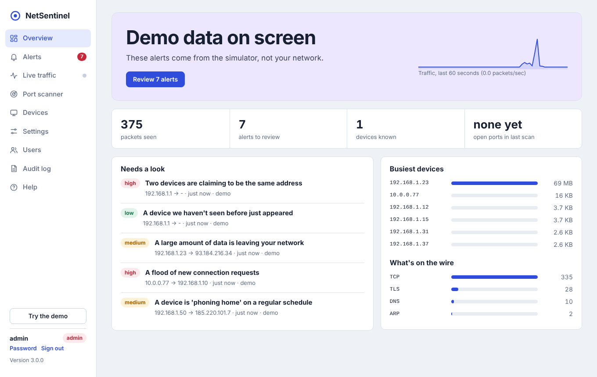

# NetSentinel

A self-hosted web app that combines **port scanning** (like Nmap), **live traffic inspection** (like Wireshark) and **rule-based threat detection** — and explains every finding in plain English.

Built for people who aren't network experts: every alert says *what was seen*, *what it might mean*, and *what to do next*; every open port is rated and explained.



## What it does

| | |
|---|---|
| **Port scanner** | Multi-threaded TCP connect scan of one host, a range, or a CIDR network. Host discovery, banner and TLS grabbing, service identification, per-port risk rating with advice. Background jobs with progress and cancel. |
| **Live traffic** | Scapy packet capture with a Wireshark-style filter (`tcp`, `dns`, `port:443`, `ip:10.0.0.5`), packet detail with hex dump, conversation table, traffic graph, device inventory from ARP. |
| **Detection engine** | 10 rules mapped to MITRE ATT&CK (below). Counts new *connections* rather than packets, de-duplicates repeats, and has tunable thresholds. |
| **Plain-English alerts** | Each alert explains itself and links to its ATT&CK technique. Review workflow, filters, CSV export and a Markdown incident report. |
| **Demo mode** | Nine safe scenarios (port scan, beaconing, ARP spoofing, SYN flood, exfiltration, a full attack chain…) so anyone can see it work without admin rights. Demo data is labelled and never written to the SIEM feed. |
| **Accounts & audit** | Sign-in with three roles, user management, and an audit trail of every sign-in, scan, setting change and denied action. |
| **SIEM-friendly** | Live alerts are also appended to rotating `alerts.jsonl` for Splunk / Elastic / Sentinel ingestion. |

| Detection | MITRE ATT&CK |
|---|---|
| Port scan (many ports, one target) | T1046 |
| Network sweep (one port, many hosts) | T1046 |
| Known-malicious port contacted | T1571 |
| C2 beaconing (regular outbound timing) | T1071 |
| Data exfiltration (large upload to one outside host) | T1041 |
| SYN flood / connection burst | T1498 |
| ARP spoofing (MAC binding change) | T1557 |
| Blocked-IP match · cleartext protocol use · new device | — |

## Single-file Windows app

Download `NetSentinel.exe` from the [Releases](../../releases) page (built automatically by GitHub Actions when a `v*` tag is pushed).
Double-click it: a console window opens (it shows the first-run setup code), your browser opens to `http://127.0.0.1:8765`, and your data is kept in a `NetSentinel-data` folder next to the exe.
Live packet capture needs [Npcap](https://npcap.com) installed and the exe started with **Run as administrator**; scanning and everything else works without either.
Windows SmartScreen may warn about an unsigned app: choose *More info, Run anyway*. To change the exe's icon, replace `assets/icon.ico` (multi-size .ico, 256x256 max) and rebuild. To build it yourself: `pip install -r requirements.txt pyinstaller && pyinstaller netsentinel.spec`.

## Quick start

```bash
git clone https://github.com/Vora-Codez/netsentinel.git && cd netsentinel
pip install -r requirements.txt
python -m netsentinel serve
```

Open <http://127.0.0.1:8765>. The first run asks for a **setup code** (printed in the terminal) and creates the administrator. Then click **Try the demo**.

### Docker

```bash
docker compose up -d --build            # dashboard, scanner and demo
docker compose logs netsentinel         # shows the first-run setup code
```

Live packet capture needs the host network (Linux): `docker compose -f docker-compose.yml -f docker-compose.sensor.yml up -d`. See [docs/DEPLOYMENT.md](docs/DEPLOYMENT.md) for HTTPS, reverse proxies and capture permissions.

## Roles

| Role | Can |
|---|---|
| **viewer** | Look at everything. Change nothing. |
| **analyst** | Scan private networks, capture, run the demo, review alerts. |
| **admin** | Everything, plus settings, users, scanning outside private ranges, and the audit log. |

Forgot the admin password? `python -m netsentinel reset-password <user>` (run on the server).

## Security model

NetSentinel is a security tool that can send traffic, so it is locked down by default:

- Binds to `127.0.0.1` unless you say otherwise; warns when exposed without HTTPS.
- Passwords hashed with scrypt; 10-character minimum; login lockout after repeated failures; identical error for unknown user vs wrong password.
- Signed `HttpOnly`, `SameSite=Strict` session cookie; per-session CSRF token on every state-changing call; Origin checks; Host allow-list against DNS rebinding.
- Changing a user's role, password or status signs them out everywhere immediately.
- Strict Content-Security-Policy (no inline script or style); every dynamic value is HTML-escaped because banners, DNS names and packet text are attacker-controlled; CSV exports neutralise formula injection.
- Scanner guardrails: private ranges only for non-admins, a consent confirmation, probe-count caps, and a hard block on link-local (cloud metadata), multicast and reserved ranges.
- First-run setup requires a code from the server log, so nobody can claim an exposed fresh install.

See [SECURITY.md](SECURITY.md) for details and how to report issues.

## Honest limitations

- **It's self-hosted by design.** A browser can't sniff packets, and a public cloud instance could only scan from the cloud, so NetSentinel runs *inside* the network it watches.
- Live capture sees what the server's network card sees. On a switched network that's its own traffic plus broadcast, unless you use a mirror (SPAN) port.
- It's a TCP *connect* scanner (no SYN/UDP/OS fingerprinting), and the detection engine is threshold-based, not machine learning. Expect to tune thresholds; some alerts (beaconing, exfiltration) can be legitimate software.
- Detection state is in memory and resets on restart. Alerts, scans, users and audit history are persisted in SQLite.

## Project layout

```
netsentinel/
  server.py      Flask app: sessions, roles, API
  auth.py        users, scrypt, throttling, audit trail
  detection.py   rule engine (sliding windows, MITRE mapping)
  capture.py     Scapy capture, packet/flow buffers, filter language
  scanner.py     target/port parsing, probing, scan jobs
  simulator.py   demo scenarios
  knowledge.py   plain-English alert + port explanations
  alerts.py db.py config.py reports.py core.py env.py
  web/           templates + static (no frameworks, works offline)
tests/           60 unit/API tests + a Playwright browser test
```

## Development

```bash
python -m unittest discover -s tests -t . -v      # unit + API tests
pip install -r requirements-dev.txt && playwright install chromium
python tests/e2e_browser.py                        # drives the real UI and refreshes docs/screenshots
```

## Roadmap

- [ ] Webhook / Slack / email alerting
- [ ] Two-factor authentication
- [ ] Scheduled scans and scan-to-scan diffing
- [ ] Persisted detection baselines
- [ ] Optional OIDC single sign-on

## Responsible use

For authorised testing of networks you own or have written permission to test. Unauthorised scanning or monitoring may violate the Computer Fraud and Abuse Act or equivalent laws. Every scan is attributed to a user in the audit log.

## Author

Jayzon Ray — Cybersecurity student, Southeast Missouri State University · [github.com/Vora-Codez](https://github.com/Vora-Codez)

MIT licensed. Evolved from a [TCP port scanner](https://github.com/Vora-Codez/python_tcp_scanner) and a [directory brute-forcer](https://github.com/Vora-Codez/dir_bruteforce): NetSentinel is the detection half of that story.
